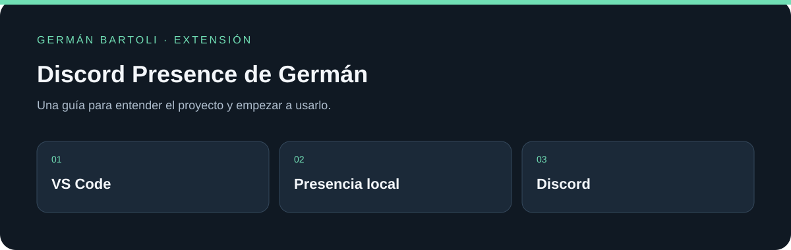

# Discord Presence de Germán

**Versión personal de Discord Presence para mostrar la actividad de VS Code en Discord, basada en el proyecto de iCrawl.**

[](https://github.com/GermanBartoli/discord-vscode)
[](https://github.com/GermanBartoli/discord-vscode/actions/workflows/tests.yml)

[Descargas](https://github.com/GermanBartoli/discord-vscode/releases) · [Empezar](#primeros-pasos) · [Mapa del repositorio](#mapa-del-repositorio) · [Autoría](#autoría-de-esta-documentación)



_Esquema de orientación; no representa una captura de la aplicación._

## Primeros pasos

1. Descargá el archivo VSIX de la release estable de este repositorio.
2. En VS Code abrí Extensiones → menú de tres puntos → **Install from VSIX…** y elegí el archivo descargado.
3. Abrí Discord de escritorio y un proyecto. Desde la paleta usá **Enable Discord Presence in the current workspace** o **Reconnect Discord Presence to Discord**.

## Qué cambia en esta versión

Esta distribución se identifica como **Discord Presence de Germán**, con publisher `GermanBartoli` y versión de aplicación 5.9.3. Conserva el proyecto original y sus créditos; los badges de la tienda de iCrawl no representan instalaciones de esta versión personal.

## Uso y privacidad

Permite habilitar o deshabilitar la presencia por espacio de trabajo y personalizar los textos desde la configuración de la extensión. Revisá los nombres de archivos y proyectos que querés mostrar antes de habilitarla. Usá **Disconnect Discord Presence from Discord** para desconectar la presencia.

## Si no conecta

Comprobá que Discord de escritorio esté abierto y usá **Reconnect Discord Presence to Discord**. En Windows ejecutá VS Code y Discord con el mismo nivel de permisos. La comunicación es local; una instalación aislada de Discord puede impedir el acceso al IPC.

## Desarrollo

Usá la versión de pnpm indicada en `package.json` y revisá su política de scripts de dependencias antes de instalar.

```powershell
pnpm install --frozen-lockfile
pnpm run build:check
pnpm run build
```

El build incluye lint y genera la extensión con esbuild. El paquete VSIX debe corresponder a esta distribución personal.

## Proyecto original

Basado en [Discord Presence de iCrawl](https://github.com/iCrawl/discord-vscode), bajo la licencia MIT incluida en el repositorio. Se conservan el autor original y sus colaboradores; Germán Bartoli mantiene esta adaptación personal.

## Mapa del repositorio

- [package.json](package.json)
- [LICENSE](LICENSE)

## Autoría de esta documentación

Repositorio mantenido por [Germán Bartoli](https://github.com/GermanBartoli). Guía revisada y actualizada con **Codex**, coautor de esta actualización documental. Los autores, colaboradores, licencias y recursos de terceros conservan sus créditos originales.

Los commits de esta revisión incluyen `Co-authored-by: Codex <noreply@openai.com>`; esta atribución no modifica la autoría del historial anterior.
